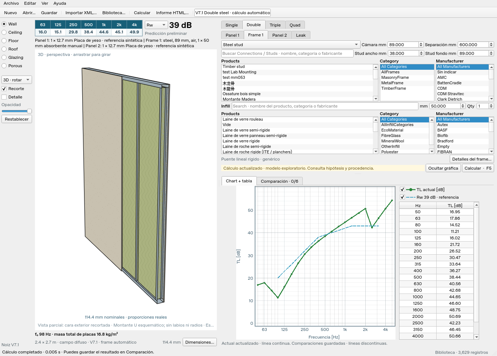

# Noiz Transmission

Aplicación open source de escritorio para estudiar el aislamiento acústico de
**elementos constructivos**. Python, PySide6, NumPy, SciPy y PyQtGraph; motor
independiente de la interfaz y catálogo de **3.629 registros** incluido.

**Versión 0.7.1 · cálculo automático y selección del frame sin parámetros avanzados.**
Single conserva el motor finito V7. Double combina la vía aérea Davy/Hansen con
puentes rígidos genéricos de Sharp (1978), con las hipótesis registradas.
Todavía no demuestra una tolerancia experimental ni equivalencia con Strutt o INSUL.



## Descargar y abrir

Descarga el [ZIP V7.1](https://github.com/oscargit010502/Noiz-Transmission/archive/refs/heads/codex/noiz-transmission-v7-1.zip),
extráelo en una carpeta nueva, instala [uv](https://docs.astral.sh/uv/getting-started/installation/)
y ejecuta **INICIAR_NOIZ.cmd** en Windows. La carpeta debe contener `pyproject.toml`.
La instalación por copia evita el problema de vínculos permanentes de OneDrive.

También puedes iniciar desde esa carpeta:

```shell
uv sync --locked --extra desktop
uv run --locked --extra desktop noiz-transmission
```

Al abrir, la partición Single inicial ya se calcula. Abre
**examples/v71_double_steel.noiz.json** o **v71_double_timber.noiz.json** y cambia
materiales, espesores, frame o relleno: los resultados se actualizan automáticamente.
**F5** sigue disponible para refrescar manualmente. Los ejemplos son sintéticos;
no son ensayos ni fichas comerciales. Consulta [cómo probarlo](PROBAR_EN_WINDOWS.md).

## Cálculo V7.1

- **Actualización automática:** 200 ms para agrupar ediciones; un solo cálculo
  activo. Una edición cancela el resultado anterior y calcula la última composición.
  Las entradas incompletas muestran su error en línea y se recuperan al corregirlas.
- **Double:** selección automática de contacto lineal, puntual o sin puente común
  según el frame. No exige compliancia, calibre de correlación ni separación de
  tornillos. **Detalles del frame…** consulta hipótesis, sin campos obligatorios.
- **Absorbente:** utiliza la resistividad explícita cuando existe. Si falta,
  toma una fibra de referencia de Hansen, tabla 7.12: **20.000 Pa·s/m²**. Miki
  usa el espesor real, también 40 mm, sin cambio artificial de modelo a 50 mm.
  Es una hipótesis interna identificada, no una propiedad medida del producto.
- **Single:** integración angular y energética de placa finita de V7; coincidencia,
  pérdidas de borde explícitas y límite de espesor de Ljunggren/Hansen.
- **Proyectos anteriores:** conservan su modelo. En Double → Frame, **Usar V7.1**
  permite actualizar explícitamente el cálculo. Los nuevos archivos usan esquema 6.
- Se mantienen **Triple/Quad de hojas independientes**, gases y Facing mediante
  las rutas anteriores; no se extiende el puente de Double automáticamente a ellas.

La aproximación rígida elimina la necesidad de una compliancia de entrada, pero
**no caracteriza la flexibilidad real del acero delgado ni de aisladores comerciales**.
Dos frames con iguales dimensiones y la misma topología genérica pueden dar el
mismo TL. No se añaden mejoras por marca ni se ajusta la curva a una captura de INSUL.
El cálculo avanzado V7 permanece disponible para reproducir datos explícitos.

Véanse [notas V7.1](docs/release-v71.md), [fuentes y ecuaciones](docs/v71-reference-review.md)
y [verificaciones independientes](docs/v71-validation.md). La combinación de caminos
se identifica como aproximación de ingeniería; no como una implementación literal
de Sharp, validación experimental ni equivalencia con INSUL/Strutt. La corrección
finita no es Sewell y el límite de espesor no resuelve todas las ondas de cortante.

## Interfaz y representación

- **Chart + tabla:** curva y valores TL visibles simultáneamente; tabla a la
  derecha, debajo de la leyenda. Gráfico cuadrado con referencia Rw/STC y sin
  zoom, arrastre ni modificación manual de ejes.
- Controles Qt compactos, grises y azules; búsqueda, filtros de categoría y
  fabricante, seis capas por panel, espesor y cantidad editables.
- Perspectiva con aristas negras visibles y ocultación por profundidad, sin
  diagonales de triangulación; montantes, soleras y rellenos diferenciados.
- Símbolos de resortes, neopreno y Sylomer identificados como **esquemáticos**.
  No equivalen a BIM ni determinan su rigidez, carga o amortiguamiento dinámico.
- Vista 2D, recorte, opacidad y rotación 3D; hasta seis comparaciones e informes
  CSV/HTML con parámetros, procedencia y advertencias.

## Alcance y comprobaciones

| Función | Estado en V7.1 |
| --- | --- |
| Single isotrópico finito | Integración de placa y pérdidas, con dominio de validez indicado |
| Double con frame automático | Vía aérea y puente rígido genérico, con hipótesis internas trazables |
| Triple/Quad independientes | Modelo anterior de matrices de transferencia |
| Aisladores comerciales y montantes especiales | Representación esquemática; requieren caracterización de la unión |
| Rw / STC | Clasificación de predicción; STC conserva el procedimiento legado 32/8 |
| Impacto IIC/Ln,w, lluvia, Gomperts/Mechel | Pendientes; no generan una curva aérea sustituta |
| Flancos y aislamiento entre recintos | Fuera del alcance |

Las verificaciones independientes comprueban ecuaciones, unidades, reciprocidad,
resonancias y suma de energías. Se incluyen cuatro espectros publicados de paredes
con montantes, identificando los datos que faltan para reproducir sus ensayos.
No se ajustan esos datos ausentes para declarar una precisión ficticia. Véase
[validación V7.1](docs/v71-validation.md).

## Materiales y datos locales

**Importar XML…** admite Material, Profile, Glazing, Floor Cover, Absorption,
Core, Stud y Connection; conserva campos originales, unidades, identificadores y SHA-256.
Los ocho XML actualizados aportados contienen **3.629 registros**. Importar un
registro no demuestra su validez experimental ni su compatibilidad con el motor.
El `Damping` de absorbentes no se convierte automáticamente en resistividad.

Desde **0.5.1**, el catálogo se distribuye como recurso del programa en
`src/noiz_transmission/data/catalog/catalog-v5.json.gz`, junto con su manifiesto
de procedencia. Está incluido en el ZIP de GitHub y en el paquete Python. Se carga
sin conexión, sin necesitar los XML originales ni escribir en la instalación.
Los materiales propios de la biblioteca local se combinan con la base; si comparten
identificador, se conserva la versión del usuario. Reimportar el mismo XML no duplica
los registros. **Importar XML…** queda disponible para ampliaciones futuras.

`NOIZ_CATALOG_PATH` es una selección explícita de una biblioteca aislada y excluye
la base integrada. Sin esa variable, las bibliotecas portátiles `catalog-v5.json`,
`catalog-v3.json` y `catalog.json` se reconocen en ese orden. Los datos de terceros
conservan su procedencia y derechos: véase el [aviso del catálogo](src/noiz_transmission/data/catalog/NOTICE.md).

Los nuevos XML no contienen enlaces legibles a drawings o BIM. Las dimensiones
de catálogo no acreditan una sección exacta de fabricante; las geometrías sin
verificar se identifican en la vista. Consulta la [auditoría de fuentes](docs/v5-geometry-sources.md).
V7 añade transmisión por montantes de madera y acero en Double con parámetros
explícitos. Impacto, lluvia y modelos dinámicos específicos de aisladores siguen pendientes.

## Reproducir sin interfaz

```shell
uv sync --locked
uv run noiz assembly examples/v71_single.noiz.json --output-dir artifacts/v7
uv run noiz assembly examples/v71_double_steel.noiz.json --output-dir artifacts/steel
uv run noiz assembly examples/v71_double_timber.noiz.json --output-dir artifacts/timber
uv run noiz catalog import ruta/Material_INSUL10.xml ruta/Stud_INSUL10.xml
```

Cada cálculo genera `result.json`, `spectra.csv` y `report.html`. Los ejemplos V7.1
usan materiales sintéticos y guardan las condiciones de cálculo. Los ejemplos
anteriores permanecen disponibles para reproducibilidad.

## Cinco componentes

| Componente | Ubicación |
| --- | --- |
| Motor físico y clasificación | `src/noiz_transmission/core/` |
| Biblioteca y materiales | `src/noiz_transmission/catalog/`, `data/` |
| Escritorio y servicios | `src/noiz_transmission/ui/`, `application/` |
| Banco de verificación | `tests/`, `validation/`, `adapters/` |
| Documentación reproducible | `docs/` |

```shell
uv sync --locked --all-extras
uv run pytest -W error
uv run ruff check .
uv run python -m build --installer uv
```

En Linux sin pantalla usa `QT_QPA_PLATFORM=offscreen uv run pytest -W error`.
La CI configura Windows y Linux; su definición no sustituye una ejecución nativa
verificada. Phonometry se instala como extra para contrastes independientes.

- [Arquitectura](docs/architecture.md) y [hoja de ruta](docs/roadmap.md)
- [Entrega V5 y comprobaciones realizadas](docs/release-v5.md) y [criterios Rw/STC](docs/v4-ratings.md)
- [Actualización 0.5.1: materiales integrados](docs/catalog-native.md)
- [Entrega V4 anterior](docs/release-v4.md)
- [Entrega V3 anterior](docs/release-v3.md)
- [Validación](docs/validation.md), [fuentes](docs/sources.md) y [revisión INSUL 10/XML](docs/v3-reference-review.md)
- [Materiales](docs/materials.md), [reproducibilidad](docs/reproducibility.md) y [contribuciones](CONTRIBUTING.md)

Código bajo [licencia MIT](LICENSE). PySide6 y las demás dependencias mantienen
sus licencias; un futuro ejecutable debe incluir los avisos correspondientes.
