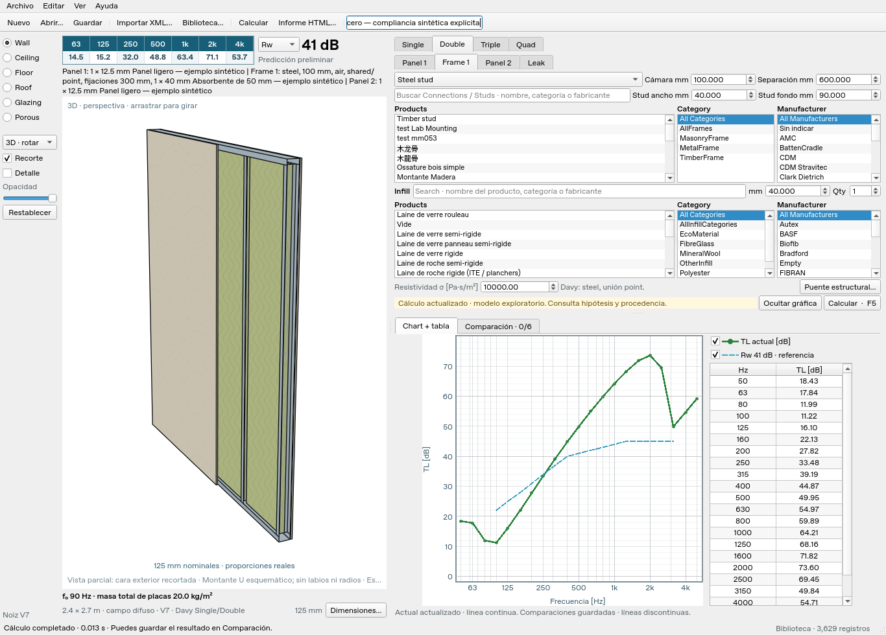

# Noiz Transmission

Aplicación open source de escritorio para estudiar el aislamiento acústico de
**elementos constructivos**. Python, PySide6, NumPy, SciPy y PyQtGraph; motor
independiente de la interfaz y catálogo de **3.629 registros** incluido.

**Versión 0.7.0 · transmisión aérea y por montantes, gráfico y tabla simultáneos.**
Esta versión implementa ecuaciones publicadas de Davy/Hansen con sus hipótesis.
Todavía no demuestra una tolerancia experimental ni equivalencia con Strutt o INSUL.



## Descargar y abrir

Descarga el [ZIP V7](https://github.com/oscargit010502/Noiz-Transmission/archive/refs/heads/codex/noiz-transmission-v7.zip),
extráelo en una carpeta nueva, instala [uv](https://docs.astral.sh/uv/getting-started/installation/)
y ejecuta **INICIAR_NOIZ.cmd** en Windows. La carpeta debe contener `pyproject.toml`.
La instalación por copia evita el problema de vínculos permanentes de OneDrive.

También puedes iniciar desde esa carpeta:

```shell
uv sync --locked --extra desktop
uv run --locked --extra desktop noiz-transmission
```

Abre **examples/v7_double_steel.noiz.json** o **v7_double_timber.noiz.json** y pulsa
**F5**. Ambos son ejemplos sintéticos completos, con dos hojas de yeso, cámara,
absorbente y montantes. Sus propiedades ilustran el cálculo; no son ensayos ni
fichas de un fabricante. Consulta [cómo probarlo](PROBAR_EN_WINDOWS.md).

## Cálculo V7

- **Single:** integración angular y por tercios de octava, tamaño finito de Davy,
  coincidencia y pérdidas adicionales de borde explícitas. En una hoja homogénea
  se aplica el límite de espesor de Ljunggren/Hansen a los centros de banda.
- **Double:** suma energética de transmisión aérea y por montantes. Madera con
  conexiones puntuales; acero con conexiones puntuales, lineales o selección
  según separación de fijaciones. La resonancia incorpora flexión entre montantes.
- **Absorbente:** espesor y resistividad explícitos mediante una aproximación de
  absorción Miki; alternativamente se declara la absorción efectiva de cámara.
  El campo Damping del XML no se transforma en resistividad.
- **Unión de acero:** especifica su flexibilidad (*compliance*) en
  **Frame → Puente estructural…**. Flexibilidad puntual y lineal tienen unidades
  distintas. La correlación por calibre se mantiene experimental: el texto
  consultado no define su convención de unidades y no se convierte desde mm.
- **Bastidores separados:** idealización sin puentes comunes. Montantes alternados
  sobre soleras compartidas no son automáticamente independientes.
- Se conservan **Triple/Quad de hojas independientes**, gases y Facing mediante
  las rutas anteriores. Cambiar de modelo es explícito; proyectos V6 mantienen
  sus fórmulas al abrirse. Los nuevos proyectos se guardan con esquema 5.

Las ecuaciones, correcciones e interpretaciones se detallan en
[fuentes V7](docs/v7-reference-review.md) y [notas de entrega](docs/release-v7.md).
Los modelos de Davy y Sharp no se mezclan mediante un empalme arbitrario. La
corrección de tamaño finito no se presenta como Sewell; el límite de espesor no
es un solucionador completo de ondas de cortante. No se resuelve un modelo modal
completo a baja frecuencia.

La consulta directa a [Strutt](https://strutt.arup.com/help/) quedó bloqueada por
la política de red del entorno. Las ecuaciones incorporadas se contrastaron con
los libros aportados; queda pendiente verificar la correspondencia exacta con
Transmission Loss Prediction de Strutt y sus fuentes primarias.

## Interfaz y representación

- **Chart + tabla:** curva y valores TL visibles simultáneamente; tabla a la
  derecha, debajo de la leyenda. Gráfico cuadrado con referencia Rw/STC y sin
  zoom, arrastre ni modificación manual de ejes.
- Controles Qt compactos, grises y azules; búsqueda, filtros de categoría y
  fabricante, seis capas por panel, espesor y cantidad editables.
- Perspectiva con aristas negras visibles y ocultación por profundidad, sin
  diagonales de triangulación; montantes, soleras y rellenos diferenciados.
- Símbolos de resortes, neopreno y Sylomer identificados como **esquemáticos**.
  No equivalen a BIM ni determinan su rigidez, carga o amortiguamiento dinámico.
- Vista 2D, recorte, opacidad y rotación 3D; hasta seis comparaciones e informes
  CSV/HTML con parámetros, procedencia y advertencias.

## Alcance y comprobaciones

| Función | Estado en V7 |
| --- | --- |
| Single isotrópico finito | Integración de placa y pérdidas, con dominio de validez indicado |
| Double de yeso con madera/acero | Vías aérea y estructural con parámetros explícitos |
| Triple/Quad independientes | Modelo anterior de matrices de transferencia |
| Aisladores comerciales y montantes especiales | Representación esquemática; requieren caracterización de la unión |
| Rw / STC | Clasificación de predicción; STC conserva el procedimiento legado 32/8 |
| Impacto IIC/Ln,w, lluvia, Gomperts/Mechel | Pendientes; no generan una curva aérea sustituta |
| Flancos y aislamiento entre recintos | Fuera del alcance |

Las verificaciones independientes comprueban ecuaciones, unidades, reciprocidad,
resonancias y suma de energías. Se incluyen cuatro espectros publicados de paredes
con montantes, identificando los datos que faltan para reproducir sus ensayos.
No se ajustan esos datos ausentes para declarar una precisión ficticia. Véase
[validación V7](docs/v7-validation.md).

## Materiales y datos locales

**Importar XML…** admite Material, Profile, Glazing, Floor Cover, Absorption,
Core, Stud y Connection; conserva campos originales, unidades, identificadores y SHA-256.
Los ocho XML actualizados aportados contienen **3.629 registros**. Importar un
registro no demuestra su validez experimental ni su compatibilidad con el motor.
El `Damping` de absorbentes no se convierte automáticamente en resistividad.

Desde **0.5.1**, el catálogo se distribuye como recurso del programa en
`src/noiz_transmission/data/catalog/catalog-v5.json.gz`, junto con su manifiesto
de procedencia. Está incluido en el ZIP de GitHub y en el paquete Python. Se carga
sin conexión, sin necesitar los XML originales ni escribir en la instalación.
Los materiales propios de la biblioteca local se combinan con la base; si comparten
identificador, se conserva la versión del usuario. Reimportar el mismo XML no duplica
los registros. **Importar XML…** queda disponible para ampliaciones futuras.

`NOIZ_CATALOG_PATH` es una selección explícita de una biblioteca aislada y excluye
la base integrada. Sin esa variable, las bibliotecas portátiles `catalog-v5.json`,
`catalog-v3.json` y `catalog.json` se reconocen en ese orden. Los datos de terceros
conservan su procedencia y derechos: véase el [aviso del catálogo](src/noiz_transmission/data/catalog/NOTICE.md).

Los nuevos XML no contienen enlaces legibles a drawings o BIM. Las dimensiones
de catálogo no acreditan una sección exacta de fabricante; las geometrías sin
verificar se identifican en la vista. Consulta la [auditoría de fuentes](docs/v5-geometry-sources.md).
V7 añade transmisión por montantes de madera y acero en Double con parámetros
explícitos. Impacto, lluvia y modelos dinámicos específicos de aisladores siguen pendientes.

## Reproducir sin interfaz

```shell
uv sync --locked
uv run noiz assembly examples/v7_single.noiz.json --output-dir artifacts/v7
uv run noiz assembly examples/v7_double_steel.noiz.json --output-dir artifacts/steel
uv run noiz assembly examples/v7_double_timber.noiz.json --output-dir artifacts/timber
uv run noiz catalog import ruta/Material_INSUL10.xml ruta/Stud_INSUL10.xml
```

Cada cálculo genera `result.json`, `spectra.csv` y `report.html`. Los ejemplos V7
usan materiales sintéticos y guardan las condiciones de cálculo. Los ejemplos
anteriores permanecen disponibles para reproducibilidad.

## Cinco componentes

| Componente | Ubicación |
| --- | --- |
| Motor físico y clasificación | `src/noiz_transmission/core/` |
| Biblioteca y materiales | `src/noiz_transmission/catalog/`, `data/` |
| Escritorio y servicios | `src/noiz_transmission/ui/`, `application/` |
| Banco de verificación | `tests/`, `validation/`, `adapters/` |
| Documentación reproducible | `docs/` |

```shell
uv sync --locked --all-extras
uv run pytest -W error
uv run ruff check .
uv run python -m build --installer uv
```

En Linux sin pantalla usa `QT_QPA_PLATFORM=offscreen uv run pytest -W error`.
La CI configura Windows y Linux; su definición no sustituye una ejecución nativa
verificada. Phonometry se instala como extra para contrastes independientes.

- [Arquitectura](docs/architecture.md) y [hoja de ruta](docs/roadmap.md)
- [Entrega V5 y comprobaciones realizadas](docs/release-v5.md) y [criterios Rw/STC](docs/v4-ratings.md)
- [Actualización 0.5.1: materiales integrados](docs/catalog-native.md)
- [Entrega V4 anterior](docs/release-v4.md)
- [Entrega V3 anterior](docs/release-v3.md)
- [Validación](docs/validation.md), [fuentes](docs/sources.md) y [revisión INSUL 10/XML](docs/v3-reference-review.md)
- [Materiales](docs/materials.md), [reproducibilidad](docs/reproducibility.md) y [contribuciones](CONTRIBUTING.md)

Código bajo [licencia MIT](LICENSE). PySide6 y las demás dependencias mantienen
sus licencias; un futuro ejecutable debe incluir los avisos correspondientes.
