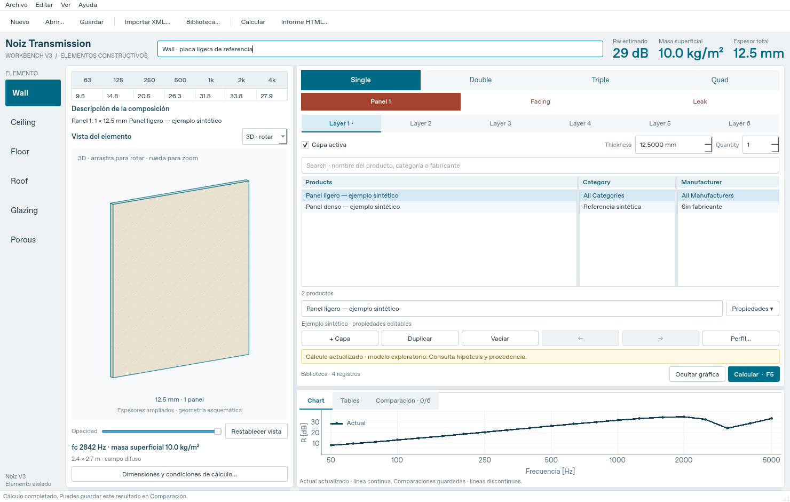

# Noiz Transmission

Aplicación open source de escritorio para estudiar el aislamiento acústico de
**elementos constructivos**, con motor físico independiente, materiales con
procedencia y resultados reproducibles. Python, PySide6, NumPy, SciPy y PyQtGraph.

**Versión 0.3.0 · prototipo científico.** La V3 reorganiza el trabajo mediante
controles anidados, incorpora cuatro hojas y tres cámaras y permite guardar las
variantes de un proyecto. La exactitud respecto a sistemas comerciales todavía
requiere validación experimental; los resultados no equivalen a un ensayo.



## Descargar y abrir

El código V3 está en la rama
[`codex/noiz-transmission-v3`](https://github.com/oscargit010502/Noiz-Transmission/tree/codex/noiz-transmission-v3).
Selecciona esa rama y usa **Code → Download ZIP**, o descarga el paquete de esta
conversación. Extrae el ZIP, instala [uv](https://docs.astral.sh/uv/getting-started/installation/)
y ejecuta **`INICIAR_NOIZ.cmd`** en Windows. Desde la carpeta del proyecto:

```shell
uv sync --locked --extra desktop
uv run --locked --extra desktop noiz-transmission
```

La primera ejecución descarga Python 3.13 y dependencias si faltan. La
[guía de Windows](PROBAR_EN_WINDOWS.md) explica cómo probar cada control y dónde
están las carpetas. Esta entrega contiene código y lanzador; no un instalador `.exe`.

## Controles de V3

- **Wall y Ceiling:** Single / Double / Triple / Quad; Panel y Frame intercalados,
  Facing en Single y Leak. Quad tiene cuatro paneles y tres Frames interiores.
- **Panel:** seis pestañas Layer, activación individual, Thickness en mm y
  Quantity de 1 a 10. Elegir un producto carga su espesor nominal, que se puede
  modificar. Búsqueda por nombre y filtros de categoría y fabricante.
- **Frame:** cámara, montante, dimensiones, separación e Infill. Quantity = 0
  retira el absorbente del cálculo y de la vista, conservando su selección.
- **Floor:** hasta Triple, Floor cover antes de Panel 1 y pestaña Floor Covering
  para consultar curvas ΔL importadas, filtradas por base ligera, pesada o CLT.
- **Roof:** Single/Double y controles Rainfall. **Glazing:** hasta Quad, sin Leak,
  con selección de gas de cámara. **Porous:** espesor y resistividad de la capa.
- Vista 3D con arrastre para rotar, rueda para zoom y opacidad; corte 2D con
  materiales diferenciados. Tabla superior en octavas, descripción, masa y fc/f₀.
- Chart y Tables en tercios de octava, hasta seis comparaciones, gráfica
  redimensionable y ocultable, exportación CSV/HTML y cálculo cancelable.
- Guardado V3 con propiedades completas y variantes de los distintos modos y
  topologías; apertura de proyectos V1/V2. Las comparaciones se exportan aparte.

## Qué calcula y qué queda pendiente

| Función | Estado en V3 |
| --- | --- |
| Transmisión aérea de 1–4 hojas isotrópicas independientes | Matrices de transferencia, flexión y amortiguamiento |
| Cámaras de aire y absorbente poroso | Modelo Miki, con resistividad explícita |
| Cámaras de argón y criptón | Propagación acústica con propiedades de gas ideal; sin Miki en esos gases |
| Facing poroso exterior y elemento Porous | Modelo Miki; no representan un revestimiento sólido adherido |
| Leak de área abierta ideal | Combina transmisiones por área; no usa profundidad ni posición |
| Gomperts / Mechel, uniones por montantes | Controles y datos conservados; cálculo bloqueado por modelo pendiente |
| Impacto Ln,w/IIC y ruido de lluvia | Controles disponibles; predicción pendiente |
| Floor Covering medido | Consulta de ΔL declarado en catálogo; no calcula el Ln del suelo completo |
| Rw | Clasificación provisional de la curva difusa; sin clasificación en incidencia normal |

No se calcula aislamiento entre recintos, flancos ni uniones de ISO 12354.
Las hojas son infinitas y las capas de una hoja comparten movimiento, con suma
de rigideces individuales: no es un modelo de laminado adherido. Una cámara con
resonancias estrechas puede tardar; el solver exige convergencia antes de entregar
la curva. Quad con relleno puede requerir varios minutos. Consulta
[teoría y supuestos](docs/theory.md) y [validación](docs/validation.md).

INSUL 10 es una referencia funcional y bibliográfica. Noiz Transmission es
independiente de Marshall Day Acoustics y no atribuye a su modelo los márgenes de
error publicados para INSUL. Las opciones pendientes no sustituyen silenciosamente
sus modelos por otras fórmulas.

## Materiales y datos locales

**Importar XML…** admite Material, Profile, Glazing, Floor Cover, Absorption,
Core y Stud; conserva campos originales, unidades, identificadores y SHA-256.
Los siete XML INSUL 10.0/8 aportados contienen **3.242 registros**. Importar un
registro no demuestra su validez experimental ni su compatibilidad con el motor.
El `Damping` de absorbentes no se convierte automáticamente en resistividad.

La distribución pública incluye ejemplos sintéticos. El paquete personal guarda
el catálogo convertido en `local_data/catalog-v3.json`, excluido de Git y del
paquete Python. También se reconoce `local_data/catalog.json` de V2; V3 tiene
preferencia si ambos existen. `NOIZ_CATALOG_PATH` permite elegir otra ruta. Sin
catálogo local se usa el almacenamiento del usuario y se ofrecen ejemplos
sintéticos para empezar. Los datos de terceros conservan sus propios derechos.

## Reproducir sin interfaz

```shell
uv sync --locked
uv run noiz assembly examples/v3_single.noiz.json --output-dir artifacts/v3
uv run noiz assembly examples/v3_quad.noiz.json --output-dir artifacts/quad
uv run noiz catalog import ruta/Material_INSUL10.xml ruta/Stud_INSUL10.xml
```

Cada cálculo genera `result.json`, `spectra.csv` y `report.html`. El ejemplo Quad
usa incidencia normal y no emite Rw; los proyectos guardan las condiciones de
cálculo. Los ejemplos V1/V2 permanecen disponibles para reproducibilidad.

## Cinco componentes

| Componente | Ubicación |
| --- | --- |
| Motor físico y clasificación | `src/noiz_transmission/core/` |
| Biblioteca y materiales | `src/noiz_transmission/catalog/`, `data/` |
| Escritorio y servicios | `src/noiz_transmission/ui/`, `application/` |
| Banco de verificación | `tests/`, `validation/`, `adapters/` |
| Documentación reproducible | `docs/` |

```shell
uv sync --locked --all-extras
uv run pytest -W error
uv run ruff check .
uv run python -m build --installer uv
```

En Linux sin pantalla usa `QT_QPA_PLATFORM=offscreen uv run pytest -W error`.
La CI configura Windows y Linux; su definición no sustituye una ejecución nativa
verificada. Phonometry se instala como extra para contrastes independientes.

- [Arquitectura](docs/architecture.md) y [hoja de ruta](docs/roadmap.md)
- [Entrega V3 y comprobaciones realizadas](docs/release-v3.md)
- [Validación](docs/validation.md), [fuentes](docs/sources.md) y [revisión INSUL 10/XML](docs/v3-reference-review.md)
- [Materiales](docs/materials.md), [reproducibilidad](docs/reproducibility.md) y [contribuciones](CONTRIBUTING.md)

Código bajo [licencia MIT](LICENSE). PySide6 y las demás dependencias mantienen
sus licencias; un futuro ejecutable debe incluir los avisos correspondientes.
