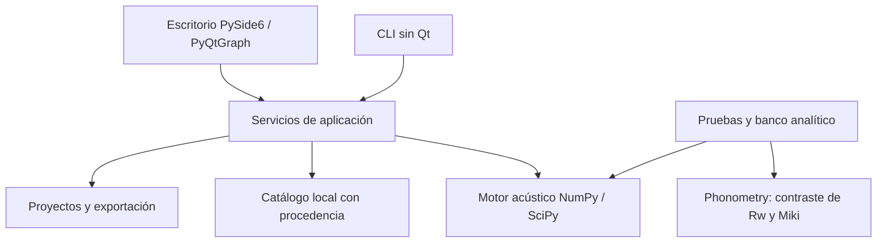

# Arquitectura de Noiz Transmission 0.5.1

Noiz Transmission es un banco de trabajo de escritorio para Windows, con interfaz
PySide6 y ejecución por comandos. Desde V3 permite componer hasta cuatro hojas, con seis
capas por hoja y cámaras intermedias. Calcula transmisión aérea directa de placas
infinitas y materiales porosos; su precisión experimental para construcciones
comerciales todavía no está determinada.

La pregunta científica sigue siendo: **¿podemos predecir razonablemente sistemas
sencillos y reproducir los resultados?** La reproducción y una interfaz completa
son necesarias, pero no sustituyen la validación del modelo físico.

## Cinco componentes

| Componente | Responsabilidad y estado V5 |
| --- | --- |
| Motor independiente | Hasta cuatro placas con masa, flexión y amortiguamiento; cámaras con gas; Miki en relleno, Facing y lámina porosa; integración energética; Rw provisional y STC legado 32/8; sin nuevas ecuaciones físicas en V5 |
| Biblioteca | XML 9.0/22 y 10.0/7–8; ocho familias, incluidas conexiones; 3.629 registros integrados; filtros, referencias explícitas y procedencia conservada; ejemplos sintéticos públicos |
| Interfaz | Single/Double/Triple/Quad → Panel/Frame → Layer; productos integrados; sección 2D y perspectiva 3D con proporciones reales, recorte y detalle opcionales; gráfica cuadrada con referencia Rw/STC y leyenda lateral; tabla, comparación y variantes |
| Banco de validación | Verificación matemática y contraste algorítmico independiente; ensayos experimentales pendientes |
| Documentación | Ecuaciones, ámbitos admitidos, unidades, fuentes, protocolos y comandos reproducibles |

## Dependencias

El motor no importa Qt ni conoce ventanas, archivos de proyecto o informes.
`core/physics.py` conserva las expresiones V1; `core/transfer.py` implementa
placas, cámaras, gases y porosos; `core/ratings.py` clasifica. `application/`
valida composiciones, coordina cálculo, proyectos e informes. `catalog/` importa
los datos locales. `data/materials.json` contiene referencias sintéticas públicas.
`ui/` presenta el editor; `tests/` y `validation/` conservan las verificaciones.

## Contratos de datos y persistencia

- Una hoja contiene de una a seis capas. Cada capa conserva espesor, densidad,
  Young, Poisson, pérdidas, cantidad de 1 a 10, activación y una copia opcional
  del registro de catálogo. Una capa inactiva conserva sus ajustes y no calcula.
- Una composición tiene una a cuatro hojas y exactamente una cámara entre cada
  par. Floor limita a tres, Roof a dos y Porous representa una lámina independiente.
  Quad tiene cuatro paneles y tres cámaras.
- La cámara conserva profundidad, gas, relleno, cantidad de 0 a 10, resistividad,
  tipo de bastidor y dimensiones/registro de montante. Cantidad cero excluye
  relleno del cálculo y de la vista; no elimina sus ajustes.
- En V5, el registro de bastidor puede pertenecer a `stud` o `connection` y se
  conserva en la misma propiedad `Cavity.stud`. Las dimensiones de una conexión
  no verifican su geometría local ni su transmisión estructural. No se añade un
  esquema de proyecto nuevo para guardar esa selección.
- El JSON V3 usa `schema_version: 3`, `model_name`, `project` activo y una lista
  opcional `variants`. Cada variante tiene una combinación única de elemento y
  número de hojas, y conserva sus propios parámetros y copias de catálogo.
- `save_workspace`/`load_workspace` conservan todas las variantes.
  `save_assembly` guarda solo la composición suministrada. `load_assembly`, usado
  por CLI, valida todo el archivo y devuelve la composición activa. No se ignoran
  errores en variantes ocultas; claves desconocidas, duplicados ambiguos, valores
  no finitos y documentos mayores de 32 MiB se rechazan.
- Los archivos V2 se migran agregando valores explícitos para los campos V3.
  Cargar no reescribe el archivo original. La ruta V1 `noiz predict` conserva sus
  ecuaciones históricas; abrir V1 en el editor registra el cambio de modelo.
- Los resultados conservan bandas, TL, índices provisionales, diagnósticos y
  advertencias. Exportar CSV/HTML/JSON no convierte un cálculo en certificado.

V2/V3 promedian transmisión energética en bandas exactas de tercio de octava,
con etiquetas nominales 50–5000 Hz y potencia incidente uniforme por Hz. La tabla
por octavas reúne tres tercios mediante sus anchos de banda. V1 evalúa centros
nominales; los procedimientos deben distinguirse al comparar.

## Ámbito físico y controles de otros modelos

Las capas de una hoja comparten desplazamiento transversal y permiten deslizamiento;
se suman masa y rigidez individual, sin unión laminada rígida. Las hojas se consideran
mecánicamente independientes. El relleno Miki supone esqueleto inmóvil y necesita
resistividad explícita; la cantidad controla el espesor efectivo. Facing aplica
el mismo fluido equivalente a la cara incidente de Single. Porous calcula una
lámina libre de material poroso sin placa ni respaldo.

Las cámaras de acristalamiento pueden usar aire, argón, kriptón o xenón ideal puro.
El aire sigue las propiedades exteriores del proyecto; los gases nobles usan
20 °C y 101325 Pa. No se permite relleno Miki dentro de un gas noble. Se conservan
impedancia y componente tangencial del número de onda, pero no se añaden modos
finitos ni transmisión por separadores.

Ancho y alto documentan la geometría. No calculan modos o pérdidas de borde; sí
intervienen en la fracción de área de una fuga geométrica. La opción `open_area`
mezcla transmisión del elemento y abertura ideal de transmisión unitaria. Los
controles Gomperts/Mechel se guardan, pero esos métodos están bloqueados al
calcular: no existe una implementación verificada de sus soluciones.

Floor y Roof abren por defecto las excitaciones de impacto y lluvia. Sus ajustes
se guardan, pero el motor rechaza esos cálculos. Es posible elegir expresamente
transmisión aérea de esa geometría, retirando un Floor Cover seleccionado. La
pestaña Floor Covering muestra la curva ΔL declarada del catálogo para su tipo de
suelo; no predice el nivel de impactos ni valida la medición. En modo Predicted
no se dibuja una curva de revestimiento inventada.

Los montantes, perfiles, núcleos y laminados no admitidos requieren modelos
específicos. Su selección no habilita acoplamiento estructural: se rechaza
calcularlos y se conserva su configuración. ISO 12354, flancos, C/Ctr, IIC,
Ln,w y L'nT,w permanecen fuera del cálculo actual.

La [ADR 0001](adr/0001-scope.md) documenta el alcance inicial V1. Las
[ecuaciones](theory.md) y [referencias V3](v3-reference-review.md) describen la
ampliación y sus límites actuales.

## Presentación V4

La interfaz utiliza el estilo nativo de Qt, fuente de 9 pt y layouts compactos.
No se sobrescriben bordes ni subcontroles de los spin boxes. La tabla superior
calcula su altura con las métricas de encabezados y filas; los productos ocupan
el espacio flexible y las propiedades adicionales son plegables.

El selector Rw/STC opera sobre la predicción vigente y las comparaciones sin
recalcular TL. `AssemblyPrediction.stc_db` es una propiedad calculada; el proyecto
conserva el esquema 3. CSV/HTML/JSON declaran también el procedimiento STC.
La vista usa una cámara en perspectiva y una sección 2D; la geometría visual de
montantes y perfiles no modifica la matriz acústica.

## Presentación y catálogo V5

`ui/spectrum_chart.py` dimensiona el área comprendida entre los ejes para que sea
cuadrada en pantalla. La frecuencia sigue siendo logarítmica y TL lineal: no se
iguala numéricamente la escala de Hz y dB. La leyenda está fuera del gráfico, a
la derecha, con controles de visibilidad de las curvas. `fitted_reference`
obtiene el contorno ajustado del mismo clasificador usado por el selector: Rw
entre 100–3150 Hz o STC legado 32/8 entre 125–4000 Hz. No se extrapola el contorno
ni se dibuja para una predicción normal, no aérea o incompleta. No se incluyen
curvas de flancos ni límites ISO 10140. La tabla superior mantiene el promedio
energético por octavas y mejora encabezados, contraste, alineación y legibilidad.

`SectionView` usa profundidad a escala 1× de forma predeterminada. **Detalle**
amplía visualmente el espesor e indica el factor; **Recorte** permite descubrir
la cámara sin modificar la composición guardada. Se conservan por separado
las piezas, la malla proyectada y la imagen rasterizada para evitar regenerarlas
en repintados ajenos a la escena. Cámara, opacidad, tamaño o densidad de píxeles
(DPR) invalidan la caché correspondiente. La resolución baja durante el arrastre
y se recupera al terminar; un límite de memoria puede reducirla en escenas muy
densas. Las transparencias se ordenan por profundidad en cada píxel.

La importación de conexiones conserva cotas, códigos y campos originales sin
traducirlos a herrajes inventados ni activar modelos acústicos no implementados.
La biblioteca muestra las URL HTTP(S) explícitas de un registro en **Referencias**;
solo se abren por selección del usuario. Los ocho XML recibidos no contienen URL
legibles de planos ni BIM. Las comprobaciones y las fuentes pendientes están en
[Geometría y procedencia V5](v5-geometry-sources.md).

La selección portátil prioriza `catalog-v5.json`, después `catalog-v3.json` y
`catalog.json`, sin sobrescribir ninguno. La variable `NOIZ_CATALOG_PATH` tiene
prioridad sobre esa búsqueda y selecciona una biblioteca aislada. Sin esa variable,
`load_application_catalog()` combina la base de `data/catalog/` con la biblioteca
local, dando prioridad a las entradas del usuario. Los recursos se leen con
`importlib.resources` sin escribir en la instalación; los JSON locales y los
bytes integrados comparten el mismo validador. Véase [Catálogo nativo](catalog-native.md).
