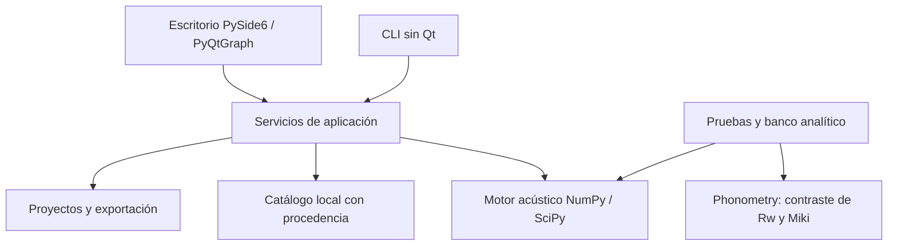

# Arquitectura de Noiz Transmission 0.2

Noiz Transmission es un banco de trabajo de escritorio para Windows, con interfaz
PySide6 y ejecución por comandos. La versión 2 permite componer elementos de una,
dos o tres hojas, con hasta seis capas por hoja y cámaras intermedias. Calcula la
transmisión aérea directa de un sistema ideal de placas infinitas; su precisión
experimental para construcciones comerciales todavía no está determinada.

La pregunta científica sigue siendo: **¿podemos predecir razonablemente sistemas
sencillos y reproducir los resultados?** La reproducción y una interfaz completa
son necesarias, pero no sustituyen la validación del modelo físico.

## Cinco componentes

| Componente | Responsabilidad y estado v2 |
| --- | --- |
| Motor independiente | Placas con masa, flexión y amortiguamiento; cámaras de aire y relleno Miki explícito; promedio energético angular y por banda; Rw provisional |
| Biblioteca | Importación XML local, búsqueda por familia/fabricante/región, propiedades y procedencia conservadas; tres materiales sintéticos públicos |
| Interfaz | Composición de hojas/capas/cámaras, biblioteca, sección constructiva, gráfica de espacio ajustable, tabla, comparación y proyectos |
| Banco de validación | Verificación matemática y contraste algorítmico independiente; ensayos experimentales pendientes |
| Documentación | Ecuaciones, ámbitos admitidos, unidades, fuentes, protocolos y comandos reproducibles |

## Dependencias

El motor no importa Qt ni conoce ventanas, archivos de proyecto o informes.
`core/physics.py` conserva las expresiones de v1; `core/transfer.py` implementa
placas y cámaras; `core/ratings.py` clasifica. `application/` valida composiciones,
coordina cálculo, proyectos e informes. `catalog/` importa y conserva los datos
locales. `data/materials.json` contiene los ejemplos sintéticos públicos. `ui/`
presenta el banco de trabajo; `tests/` y `validation/` conservan las verificaciones.

## Contratos de datos

- Un panel contiene entre una y seis capas en contacto. Cada capa conserva nombre,
  espesor, densidad, módulo de Young, Poisson, pérdidas, cantidad y, cuando existe,
  una copia del registro de catálogo utilizado.
- Una composición tiene entre uno y tres paneles y exactamente una cámara entre
  cada par. Las cámaras conservan profundidad, relleno, resistividad explícita y
  descripción del bastidor. Describir un bastidor no implementa su acoplamiento.
- Los proyectos v2 usan JSON versionado con copias de las propiedades y su
  procedencia; un catálogo actualizado no altera esas entradas guardadas.
- Los proyectos v1 mantienen su ruta de cálculo histórica mediante `noiz predict`.
  Al migrarlos al editor v2 cambia el modelo: se añade rigidez y promedio en banda.
  La migración debe informar ese cambio; no promete la curva antigua.
- Los resultados conservan bandas, TL, índices provisionales, diagnósticos y
  advertencias. Exportar CSV/HTML/JSON no transforma un resultado en certificado.
- Las funciones físicas rechazan valores no finitos, dimensiones no positivas,
  constantes inestables y configuraciones que requieren física no implementada.

Los valores v2 son promedios energéticos en bandas exactas de tercio de octava,
identificadas mediante etiquetas nominales de 50 a 5000 Hz. La potencia incidente
se supone uniforme por Hz dentro de cada banda. V1 continúa evaluando sus puntos
centrales nominales: los dos procedimientos deben distinguirse al comparar.

## Ámbito admitido

Las capas de una hoja comparten desplazamiento transversal y permiten deslizamiento;
se suman masa y rigidez individual, sin considerar una unión laminada rígida.
Las cámaras no transmiten fuerzas mediante montantes. El relleno opcional usa un
fluido equivalente de esqueleto inmóvil con resistividad introducida explícitamente.
Ancho y alto documentan la geometría y su representación; el modelo infinito no
calcula modos o pérdidas de borde a partir de esas dimensiones. Una fuga puede
representarse únicamente como fracción de área abierta de transmisión unitaria,
sin difracción ni resonancias de abertura.

Los campos que describen perfiles, revestimientos o conexiones no habilitan
algoritmos correspondientes. No se obtiene una predicción de un montaje real con
montantes simplemente al importar su geometría. Las configuraciones no admitidas
se rechazan al calcular, conservando la posibilidad de inspeccionar los datos.

ISO 12354, transmisión lateral, impacto, lluvia, STC, C/Ctr, IIC, Ln,w y L'nT,w
siguen fuera del cálculo actual. Un suelo o una cubierta pueden describirse como
elementos sometidos a ruido aéreo; eso no produce un índice de impacto o lluvia.

La decisión [ADR 0001](adr/0001-scope.md) documenta el alcance inicial v1; esta
página y [theory.md](theory.md) describen la ampliación efectiva v2. Véase también
[la revisión de referencias](v2-reference-review.md).
