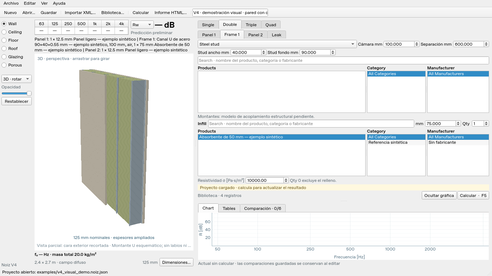

# Entrega V4 · 0.4.0

V4 reduce la altura ocupada por controles y cabeceras, amplía las listas de
productos y corrige la vista del elemento. El motor y los proyectos mantienen
su separación de la interfaz; el formato de proyecto sigue siendo el esquema 3.

## Interfaz disponible

- Fuente de 9 pt y controles nativos de Qt. Se retiran los estilos que redefinían
  tamaños, bordes y flechas de los controles numéricos.
- Menú y barra de herramientas de unos 50 píxeles lógicos en el entorno probado.
  La tabla de octavas y el selector de clasificación comparten el resumen izquierdo.
- Las dos filas de octavas quedan visibles. Search, Thickness y Quantity están
  en una fila; las propiedades adicionales son desplegables.
- Single muestra 19 productos completos a 1366×768 y 16 a 1280×720, con la fuente
  y distribución iniciales. Frame conserva visibles las listas de Stud e Infill.
- Gráfica ajustable y ocultable. Se conservan variantes, comparaciones, exportación
  y cálculo cancelable. El mínimo es 1024×620; algunas páginas avanzadas necesitan
  desplazamiento en ese tamaño.
- Rw y STC se seleccionan sin recalcular el espectro. STC usa el procedimiento
  **legado 32/8 provisional**, identificado en JSON, CSV y HTML. No se afirma
  conformidad con una edición normativa de ASTM E413. Véanse los
  [criterios y verificaciones](v4-ratings.md).

IIC y Ln,w no reciben valores porque el motor de impacto está pendiente. L’nT,w
corresponde a recintos y no se ofrece como sustituto de Ln,w del elemento.

## Representación del elemento

La cámara usa proyección en perspectiva y ocultación por profundidad por píxel.
Una vista parcial, identificada bajo el dibujo, recorta la cara exterior para
exponer el relleno. El recorte no modifica el elemento ni su cálculo. El arrastre
gira en el sentido del cursor, con una vista previa durante el movimiento y
resolución completa al soltarlo.

Las paredes tienen una sección 2D alta y estrecha; los elementos horizontales
mantienen la orientación correspondiente. Madera y metal se representan de forma
distinta. El montante metálico usa una sección U abierta esquemática y el espesor
de chapa del catálogo cuando existe. Sin datos de labios o radios no se inventa
una sección exacta de fabricante. Los perfiles corrugados y trapezoidales utilizan
paso, altura y anchuras declarados; el espesor nominal de chapa se distingue de
la envolvente geométrica.

Abre [`examples/v4_visual_demo.noiz.json`](../examples/v4_visual_demo.noiz.json)
para probar Wall/Double y Roof/Single. Sus materiales y geometrías son sintéticos,
con definiciones y huellas SHA-256 incorporadas. La representación no implementa
la transmisión estructural de uniones ni la acústica de chapas perfiladas.

## Comprobaciones

La entrega se verifica en Linux, Python 3.13.5 y PySide6 6.10.3, con Qt offscreen.
La revisión de presentación utiliza procesos independientes a escalas 100%, 125%
y 150%, con tamaños expresados en píxeles lógicos. Esto no equivale a ejecutar
nativamente Windows 11 ni a disponer del mismo espacio en una pantalla física
pequeña con escalado alto.

Se verificaron clics reales en ambas flechas de Thickness y Quantity con estilos
Windows y Fusion, aplicación de valores al proyecto, edición pendiente seguida
de F5, cambio Rw/STC, tabla completa, sentido del giro y visibilidad del relleno.
Las pruebas de render cubren perspectiva, ocultación de piezas tras una placa
opaca, sección U abierta, dimensiones de perfiles y exclusión del relleno con
Quantity = 0.

| Comprobación | Resultado |
| --- | --- |
| `pytest -q -W error --tb=short` | 603 pruebas aprobadas en 58,87 s |
| `ruff check .` y `git diff --check` | Correctos |
| `uv sync --locked --all-extras --python 3.13` | Entorno reproducible con lockfile |
| `python -m build --installer uv` | Wheel y sdist 0.4.0 construidos |
| Wheel instalado fuera del checkout | Inicio Qt, cuatro referencias públicas, cálculo Single de 21 bandas, Rw 29 / STC 28 |
| CLI Single | JSON, CSV y HTML con clasificación y procedimiento STC |

Las pruebas liberan sus ventanas Qt al finalizar para evitar acumular widgets
ocultos durante los cambios de estilo; no se han alterado sus comprobaciones.

El ejemplo `v3_single.noiz.json`, compatible con V4, produce **Rw 29 dB y STC 28**.
Son resultados del ejemplo sintético, no una validación experimental de un producto.

La [guía de Windows](../PROBAR_EN_WINDOWS.md) describe descarga y ejecución.
El paquete personal incluye los 3242 registros locales ya convertidos de los XML;
el código público incluye referencias sintéticas. Los datos y capturas privados
no se incluyen en Git ni en el paquete Python. La entrega contiene fuente y
lanzador `.cmd`; todavía no incluye instalador `.exe`.
