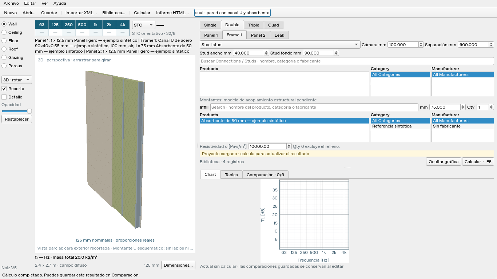

# Entrega V5 · 0.5.0

V5 mejora la representación del elemento, incorpora los ocho XML actualizados
y presenta el espectro con ejes físicamente cuadrados, leyenda lateral y contorno
de referencia Rw/STC. Conserva los controles Qt compactos de V4 y el esquema 3
de los proyectos. No añade modelos acústicos de uniones, impacto o lluvia.

## Vista del elemento

3D y 2D usan proporciones reales por defecto. **Recorte** permite descubrir el
interior sin modificar el elemento; **Detalle** amplía el espesor únicamente
para inspección y muestra el factor aplicado. La cámara gira en el sentido del
cursor y usa perspectiva. Los elementos horizontales conservan su orientación.

La geometría y la imagen se reutilizan mientras no cambien los datos, la cámara,
la opacidad o el tamaño. La imagen respeta la densidad de píxeles de la pantalla.
Las superficies transparentes se ordenan por profundidad de cada píxel. Para
limitar memoria en escenas con muchas capas transparentes se reduce la resolución
de representación, conservando las piezas y sus datos.

El ejemplo público `examples/v4_visual_demo.noiz.json` se conserva para comparar
la misma geometría entre versiones: Wall/Double con montante y absorbente, y
Roof/Single con chapa trapezoidal. **La sección U es esquemática**; sin cotas de
labios o radios no se presenta como un perfil comercial exacto. Las conexiones
sin geometría suficiente se identifican mediante notas y envolventes. Las cotas
incompatibles no se corrigen suponiendo errores decimales del catálogo.

## Resultados y gráfico

La tabla superior conserva las siete octavas, 63–4000 Hz, con cabecera contrastada
y valores centrados en negrita. Su altura y anchura consideran las métricas de
los controles nativos para evitar valores cortados. Se mantiene el método de
agrupación del espectro existente.

El área encerrada por los ejes del gráfico es cuadrada al redimensionar la
ventana, mover el separador o recuperar la gráfica oculta. Esto controla la
longitud física de los ejes, sin equiparar unidades de Hz y dB. La frecuencia
permanece logarítmica. La leyenda derecha tiene casillas independientes y
desplazamiento cuando hay muchas alternativas.

- **Rw:** contorno ajustado en las 16 bandas de 100 a 3150 Hz.
- **STC:** contorno ajustado en las 16 bandas de 125 a 4000 Hz, con el procedimiento
  legado 32/8 provisional descrito en [criterios de clasificación](v4-ratings.md).
- El selector cambia el índice y su contorno sin recalcular el espectro; no se
  extrapolan referencias fuera de sus bandas. Incidencia normal y espectros
  incompletos no reciben una curva normativa ficticia.
- Las alternativas guardadas mantienen sus espectros y su estado visible/oculto.
  La referencia pertenece al resultado actual. Editar invalida ese resultado y
  retira su referencia hasta obtener un nuevo cálculo.

No se dibujan curvas de flancos ni límites ISO 10140. El separador permite ampliar
la gráfica o las listas de productos según la tarea. Las escalas de pantalla se
han revisado en procesos Qt independientes; no se compensa el escalado del sistema
alterando las dimensiones físicas de los materiales.

## Biblioteca actualizada

| Familia | Registros |
| --- | ---: |
| Material | 1575 |
| Absorption | 523 |
| Floor Cover | 669 |
| Glazing | 80 |
| Profile | 281 |
| Core | 45 |
| Stud | 69 |
| Connection | 387 |
| **Total** | **3629** |

Frame permite seleccionar **Stud o Connection**, preservando el registro completo
y su origen. Connection carga las dimensiones declaradas y la separación cuando
su bandera lo habilita; si la declara fija, el editor bloquea esa entrada. No se
interpreta un código numérico de conexión como una definición CAD.

El paquete personal contiene `catalog-v5.json`, los ocho originales en `xml-v5/`,
su manifiesto SHA-256 y `v5_catalog_demo.noiz.json`. El ejemplo Single utiliza una
placa del catálogo; Double muestra IsoMax y un absorbente sin inventar resistividad.
El cálculo de esa unión permanece bloqueado. Los datos de terceros no se incluyen
en Git ni en el paquete Python público.

**Los ocho XML no contienen enlaces legibles a planos, drawings o BIM.** Se
conservan campos originales, fabricantes y dimensiones. Las consultas externas
a fabricantes quedaron bloqueadas por la política de red de esta sesión; no se
afirma haber verificado esos planos. La [auditoría geométrica](v5-geometry-sources.md)
identifica las fuentes revisadas y los datos inconsistentes.

La pestaña Referencias de la biblioteca presenta enlaces HTTP(S) explícitos cuando
existen y solo los abre por acción del usuario. Los proyectos V1–V4 se pueden abrir;
un proyecto V5 que incorpora Connection requiere V5, aunque conserve el esquema 3.
La selección de `catalog-v5.json` tiene prioridad sobre los catálogos anteriores;
estos no se borran ni se combinan automáticamente.

## Instalación y comprobaciones

La instalación de uv usa **copia** para evitar el error 396 de OneDrive con
vínculos permanentes. El lanzador `INICIAR_NOIZ.cmd` configura también
`UV_LINK_MODE=copy`. La [guía Windows](../PROBAR_EN_WINDOWS.md) incluye los comandos,
el recorrido de prueba y la conservación de materiales propios.

Las comprobaciones se realizan en Linux, Python 3.13.5, PySide6 6.10.3 y Qt
offscreen. Las pruebas cubren el gráfico cuadrado, contornos ajustados, leyendas,
tabla sin elipsis a 100/125/150%, las seis clases de elemento, transparencia,
caché, catálogos y guardado/apertura de conexiones. La ejecución nativa del
lanzador en Windows queda pendiente.

| Comprobación | Resultado |
| --- | --- |
| `pytest -q -W error --tb=short` | 671 pruebas aprobadas en 70,35 s |
| `ruff check .` y `git diff --check` | Correctos |
| `uv sync --locked --all-extras --python 3.13` | Entorno reproducible con lockfile |
| `python -m build --installer uv` | Wheel y sdist 0.5.0 construidos, sin XML ni catálogo privado |
| Wheel instalado fuera del checkout | Inicio Qt, cuatro ejemplos públicos, cálculo Single de 21 bandas, Rw 29 / STC 28, referencias de 16 bandas y ejes cuadrados |
| CLI Single | JSON, CSV y HTML generados con la clasificación y procedencia |
| Revisión independiente de presentación | 1366×768, 1280×720 y 1024×680 a escalas Qt 100/125/150% |

El caso sintético `examples/v3_single.noiz.json` mantiene **Rw 29 dB / STC 28**;
el caso personal de placa de 10 mm produce **Rw 27 dB / STC 23**. Son predicciones
de esas entradas, no una validación experimental ni una garantía de precisión
equivalente a INSUL.
