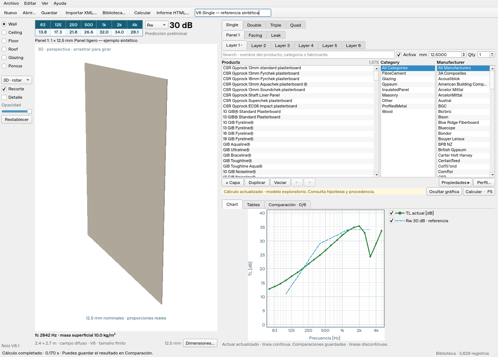

# V6.1 · interfaz compacta

Versión `0.6.1`. Actualización de presentación y manejo de la interfaz de V6.
Se conserva el estilo nativo de Qt, incluidos los botones de los campos numéricos,
las pestañas, los cuadros de texto y la selección de listas.

- Controles de 8,5 pt y listas de productos, categorías y fabricantes de 8 pt.
  Las filas se dimensionan según la fuente y el escalado de pantalla.
- Dimensiones del montante junto al buscador, contador en la cabecera y avisos
  agrupados. Se recupera espacio vertical para las listas y se amplía la gráfica.
- Gráficos de resultados y Floor Covering sin zoom, desplazamiento, historial
  de zoom ni menús de modificación de ejes. La aplicación sigue ajustando las
  escalas al calcular. Las casillas de la leyenda mantienen su función.
- Se conservan los ejes físicamente cuadrados, leyenda a la derecha y referencias
  Rw/STC. La rotación y el zoom de la vista del elemento 3D siguen disponibles.

No cambia el motor físico, el formato de proyectos ni el catálogo integrado.
Los puentes estructurales por montantes y los modelos de impacto y lluvia siguen
pendientes, con los mismos límites indicados en [V6](release-v6.md).

## Abrir esta versión

Descarga el [ZIP de V6.1](https://github.com/oscargit010502/Noiz-Transmission/archive/refs/heads/codex/noiz-transmission-v6-1.zip),
extrae su contenido en una carpeta nueva y ejecuta `INICIAR_NOIZ.cmd`.
El lanzador conserva la instalación por copia compatible con OneDrive.

## Verificación

102 pruebas de interfaz aprobadas en Linux con Qt en modo offscreen.
Eventos reales de ratón y teclado, flechas nativas de
spin boxes, filtrado del catálogo, referencias Rw/STC, comparación y escalado
de pantalla al 125 % y 150 %. Se comprueba que las listas Frame e Infill muestran
al menos cinco filas completas a 1366 × 768 y que la tabla de octavas no se corta.
Comprobación visual en Qt sobre Linux; el aspecto nativo exacto depende de Windows.

